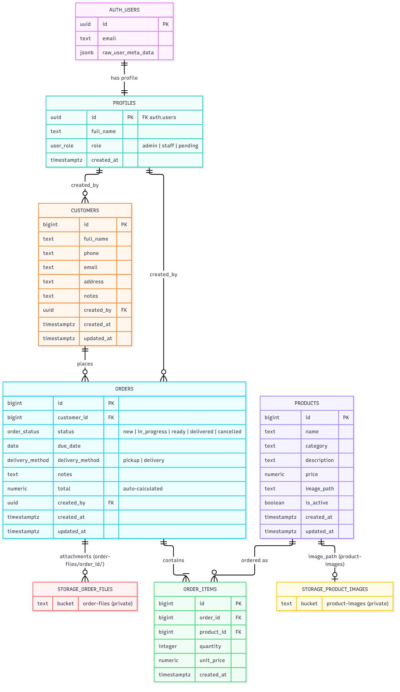

# 🎂 CRM לקונדיטוריה

מערכת CRM לקונדיטוריה לניהול לקוחות, מוצרים והזמנות.
צד לקוח: React + Vite. צד שרת: Supabase (Postgres, Auth, Storage, RLS).

## מה המערכת כוללת

| דרישה | מימוש |
|---|---|
| **Login system** | מסכי התחברות, הרשמה ואיפוס סיסמה (`src/pages/AuthPage.jsx`) |
| **Authentication** | Supabase Auth עם אימייל וסיסמה. בכל הרשמה טריגר יוצר שורה בטבלת `profiles`. |
| **Authorization / RLS** | RLS מופעל על כל הטבלאות, עם מדיניות לפי תפקיד: `admin`, `staff`, `pending` |
| **Storage** | שני באקטים פרטיים: `product-images` לתמונות מוצרים ו-`order-files` לקבצים שמצורפים להזמנה. הקבצים מוצגים באמצעות Signed URLs. |

## תרשים מסד הנתונים



## הרשאות (RLS)

| טבלה / באקט | pending | staff | admin |
|---|---|---|---|
| `profiles` | רק השורה שלו | צפייה בכל הצוות, עריכת השם שלו | כל הפעולות, כולל שינוי תפקידים |
| `customers` | ✗ | צפייה, הוספה ועריכה | + מחיקה |
| `products` | ✗ | צפייה | ניהול מלא |
| `orders` / `order_items` | ✗ | צפייה, יצירה ועדכון | + מחיקת הזמנה |
| Storage `product-images` | ✗ | צפייה | העלאה ומחיקה |
| Storage `order-files` | ✗ | ניהול מלא | ניהול מלא |
| משתמש אנונימי (`anon`) | אין שום גישה | | |

- **המשתמש הראשון** שנרשם הופך אוטומטית ל-admin. כל משתמש אחריו מקבל `staff` ונכנס מיד למערכת. מנהל יכול לחסום משתמש במסך "משתמשים" על ידי שינוי התפקיד שלו ל-`pending`.
- **משתמש לא יכול לשנות את התפקיד של עצמו.** ה-`WITH CHECK` של מדיניות העדכון חוסם את זה.
- **פונקציות העזר** (`is_staff`, `is_admin`) נמצאות בסכמה `private`, שלא נחשפת ב-API.
- **יצירת הזמנה** מתבצעת דרך הפונקציה `create_order`, שהיא `SECURITY INVOKER`, כך ש-RLS ממשיך לחול עליה. המחיר נלקח מטבלת המוצרים ולא מהדפדפן.

## התקנה והרצה

```bash
npm install
cp .env.example .env.local   # למלא URL + Publishable key מ-Supabase Dashboard > Settings > API Keys
npm run dev                  # http://localhost:3000
```

## מסד הנתונים

כל הסכמה נמצאת בקבצי migration בתיקייה `supabase/migrations/`:

```bash
supabase link --project-ref <project-ref>
supabase db push
```

בדיקת RLS רצה בתוך טרנזקציה שמתבטלת (rollback) בסופה, ולכן לא משאירה נתונים במסד:

```bash
supabase db query --linked -f supabase/tests/rls_smoke_test.sql
```

## מבנה הפרויקט

```
src/
  App.jsx              ניהול session, תפקיד המשתמש וניווט
  supabaseClient.js    Supabase client ועזרי Storage
  pages/
    AuthPage.jsx       התחברות, הרשמה ואיפוס סיסמה
    Dashboard.jsx      סטטיסטיקות והזמנות קרובות
    Customers.jsx      ניהול לקוחות
    Products.jsx       קטלוג מוצרים עם העלאת תמונות
    Orders.jsx         הזמנות, פריטים, סטטוס וקבצים מצורפים
    Users.jsx          ניהול הרשאות (מנהל בלבד)
supabase/
  migrations/          סכמה, RLS, Storage
  tests/               בדיקת RLS
docs/erd.png           תרשים מסד הנתונים
```
